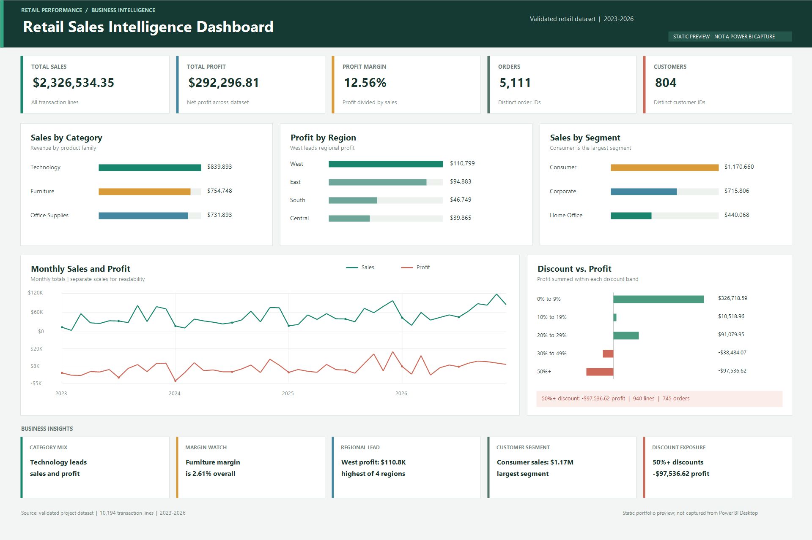

# Retail Sales Intelligence & Business Analytics

## Overview
This student BI project analyzes the transaction-level dataset in `data/superstore_clean.csv` using SQL and Excel, with a Power BI dashboard planned as the final presentation layer.

## Business Problem
The dataset captures a large number of retail transactions across multiple categories, regions, segments, and product lines. The business question is not just where revenue is highest, but which areas create sustainable profit, where discounting creates losses, and which products or customer segments deserve operational focus.

## Objectives
- Validate the dataset and preserve its transaction-line grain.
- Analyze sales, profit, customers, products, regions, and discounts.
- Present the results through SQL, Excel, and Power BI.

## Dataset
The source data is stored in `data/superstore_clean.csv` and contains 10,194 transaction rows across 21 columns. The dataset covers 5,111 distinct orders and 804 distinct customers. The earliest order date is 2023-01-03 and the latest order date is 2026-12-30. The total sales are $2,326,534.35 and total profit is $292,296.81, which yields a 12.56% profit margin.

## Data Quality Checks
- Rows: 10,194
- Columns: 21
- Duplicate rows: 0
- Missing values: none across all fields
- Invalid dates: 0
- Negative sales rows: 0
- Negative profit rows: 15
- Invalid discount rows: 0
- Unique orders: 5,111
- Unique customers: 804
- Distinct products: 1,862
- High-discount rows (discount >= 50%): 940
- High-discount orders: 745
- High-discount loss: -$97,536.62

## Workflow
`Dataset -> Data cleaning/validation -> SQL analysis -> Excel business analysis -> Dashboard Preview -> Business insights`

## SQL Analysis
The SQL workflow is located at `sql/retail_sales_analysis.sql` and includes sections for data validation, KPI analysis, category analysis, sub-category analysis, regional analysis, segment analysis, time analysis, discount analysis, product analysis, customer analysis, and advanced SQL.

## Excel Analysis
The workbook at `excel/Retail_Sales_Business_Analysis.xlsx` contains an independent analysis built from the verified dataset. It includes a data table, KPI summary, sales analysis, profitability analysis, product/customer analysis, and a business insights sheet.

## Power BI Dashboard
The dashboard is not complete. The `powerbi/` folder contains the build specification, DAX definitions, and KPI validation checklist needed to finish it in Power BI Desktop. No PBIX currently exists, and the report visuals have not been validated.

## Dashboard Preview



This is a static dashboard preview based on the project's validated retail-sales analysis, not a screenshot captured from Power BI Desktop.

## Key Metrics
- Total sales: $2,326,534.35
- Total profit: $292,296.81
- Profit margin: 12.56%
- Quantity sold: 38,654 units
- Total orders: 5,111
- Total customers: 804
- Average order value: $455.20
- Best sales category: Technology ($839,893.28)
- Best profit category: Technology ($146,543.38)
- Most profitable region: West ($110,798.82)
- Largest segment by sales: Consumer ($1,170,659.79)

## Key Insights
- Technology is the strongest revenue and profit category, generating $839,893.28 in sales and $146,543.38 in profit.
- Furniture produced $754,747.76 in sales but only $19,730.00 in profit, creating a margin of 2.61%.
- West led regional performance at $739,813.61 in sales and $110,798.82 in profit.
- Consumer contributed the most sales at $1,170,659.79 and generated $136,371.45 in profit.
- Orders with discounts of 50% or more produced a $97,536.62 loss across 940 transaction rows and 745 orders.
- The dataset has no duplicate rows and no missing values, which makes the analysis suitable for a clean BI portfolio narrative.
- The project reflects a true transaction-line dataset rather than a simplified order-only model, which is critical for valid retail analysis.

## Business Recommendations
- Tighten discount approval rules for orders with discounts of 50% or more.
- Review Furniture pricing and product mix to improve overall margin structure.
- Protect and expand the high-margin Technology portfolio, especially where demand remains strong.
- Focus customer and regional campaigns on the strongest performing combinations rather than broad discounting.
- Use the product and customer rankings to direct inventory planning and retention strategies.

## Project Structure
```text
retail-sales-intelligence/
├── data/
│   └── superstore_clean.csv
├── sql/
│   └── retail_sales_analysis.sql
├── excel/
│   └── Retail_Sales_Business_Analysis.xlsx
├── powerbi/
│   ├── POWERBI_BUILD_SPEC.md
│   ├── POWERBI_VALIDATION.md
│   └── Retail_Sales_Intelligence_DAX.md
└── README.md
```

## How to Run
1. Open the dataset in `data/superstore_clean.csv`.
2. Run the SQL script in `sql/retail_sales_analysis.sql` in MySQL Workbench or a compatible client.
3. Open the workbook in `excel/Retail_Sales_Business_Analysis.xlsx` in Excel.
4. In Power BI Desktop, complete the report following `powerbi/POWERBI_BUILD_SPEC.md` and its DAX definitions.
5. Reconcile the dashboard against the expected values in `powerbi/POWERBI_VALIDATION.md`.

## Limitations
- The PBIX, report pages, visuals, and interactive behavior are not yet complete or validated.
- The dataset reflects transaction-level data and should not be mistaken for a precise order-only source without distinct-order logic.
- This project is analysis-first and portfolio-focused rather than a productionized client implementation.

## License and Source Rights
This project uses the underlying retail dataset as the analytical input and does not reuse the original GitHub repository materials. No upstream license file was found in the source repository, so the original materials were not redistributed or presented as the author’s own work. This project was rebuilt as a clean-room analysis based on the available data and independent documentation.
